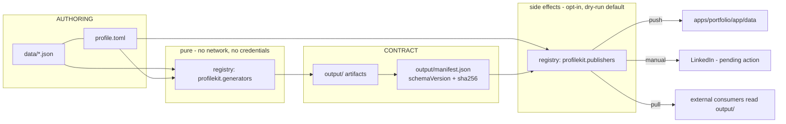

# Design: Open Source Release

## Technical Approach

Turn a `__file__`-anchored personal pipeline into an installable tool with three layers:
**authoring** (`data/`), **generation** (pure, writes only into `output_dir`), **publication**
(network/credential side effects). Three structural moves carry the change:

1. **A `ProjectContext` value object** replaces every `__file__`-derived constant. Paths come from
   discovery, not from module location.
2. **One entry-point registry** replaces the two hardcoded generator lists
   (`generators/cli.py:33-38` = 4 entries vs `generators/generate_all.py:20-24,33-37` = 5). The CLI
   derives its target list from the registry, so a second list cannot exist to diverge.
3. **`output/manifest.json`** becomes the public contract surface *and* the idempotency ledger:
   `schemaVersion` + `sha256` per artifact. Publishers consume the manifest, never the generators.

Refactor first (R0→R1→R2→R6→R8→R7), contract second (R3), outward writes last (R4→R5).

---

## Architecture Decisions

### D1 — Publication core ships in the package; credentialed adapters do not

| Option | Tradeoff | Decision |
|---|---|---|
| **A.** Repo-local `.github/` workflows only | Package stays a pure, auditable function of data→files. But every adopter reimplements capability modelling, dry-run, and idempotency in YAML; the `manual`-vs-`push` honesty rule (brief L137-144) would live in no shared code and would be re-broken per fork. | Rejected |
| **B.** Full publication in-package, credentialed adapters bundled | One install, best DX. But the wheel gains an HTTP stack and provider SDKs as *mandatory* transitive dependencies for users who publish nothing, and every adapter CVE becomes this project's release obligation. | Rejected |
| **C.** Core in-package (protocol, capability, dry-run, hashing, isolation) + two zero-credential built-in kinds + credentialed adapters as separate opt-in entry-point distributions + CI as a documented template | One more documented extension point to support. | **Chosen** |

**Rationale.** The usual objection to C — "a core with no adapters is a useless abstraction" — does
not hold here, and that is the deciding fact. The package ships **two built-in publisher kinds that
need zero credentials and zero network**: `filesystem` (local destination directory) and `manual`
(emit artifact + report a pending human action). Those two cover both real destinations this repo has
today: `apps/portfolio/app/data/` (filesystem) and LinkedIn (manual, per the write-access constraint).
So the core is a *working feature* standalone, not scaffolding. Option A cannot express `manual`
honestly in YAML; option B taxes every user with a network dependency they did not ask for.

**Credential obligation this creates — stated concretely.** In-package publication makes secrets flow
*through* code we distribute. The design accepts five specific duties, each with a mechanism:

| Duty | Mechanism |
|---|---|
| No disclosure via logs/tracebacks/diffs | Secrets are wrapped in `Secret`; `__repr__`/`__str__` return `Secret(***)`. `PublishPlan.changes` is byte-count and path summaries only, never response bodies. |
| Never persist a secret | Core resolves credentials per-invocation and holds no cache; `.profilekit/publish-state.json` stores only artifact digests. |
| No supply-chain tax | Core declares **zero network dependencies**; `filesystem`/`manual` are stdlib-only. Any HTTP client arrives with an out-of-tree adapter. |
| Structural inability to publish from tests/CI | `--dry-run` is the default; `publish.yml` is separate from `validate.yml`, which holds no secrets. |
| Vulnerability response | `SECURITY.md` (R1) plus a stated non-goal: this project is not a secret store and integrates no vault backend. |

### D2 — Project discovery: explicit flag → env → upward `profile.toml` search → fail

**Precedence** (first match wins, no silent fallback to CWD):

| Rank | Source | Note |
|---|---|---|
| 1 | `--project <dir>` | Highest; useful for CI and tests |
| 2 | `PROFILEKIT_PROJECT` | Env; CI-friendly |
| 3 | Nearest `profile.toml` walking up from CWD to filesystem root | The normal path |
| 4 | *(none)* | **Exit 2**: `no profile.toml found in <cwd> or any parent; run 'profile init'` |

Individual paths override in the same order: `--data-dir`/`--output-dir` → `[paths]` in `profile.toml`
→ defaults (`<root>/data`, `<root>/output`, `<root>/assets`). Discovery **never** consults `__file__`,
and never treats the installed package directory as a project root. Symlinks are resolved before the
upward walk; the walk stops at a filesystem boundary or `/`.

**Migration path for the 8 coupled modules.** Each gains `ctx: ProjectContext` as its first parameter
and loses its module-level constants — a mechanical, one-commit-per-concern pass under R6:

| Module | Removed | Replaced by |
|---|---|---|
| `generators/utils.py:8-10` | `SCRIPT_DIR`, `ROOT_DIR`, `OUTPUT_DIR` | `ctx.root`, `ctx.output_dir` (already-parameterised `load_json(filename, data_dir)` and `write_output(content, output_dir, filename)` are unchanged) |
| `generators/cli.py:18-29` | `_ROOT_DIR`, `sys.path` bootstrap, `OUTPUT_DIR` | `discover_project()`; the bootstrap dies with src-layout (D4) |
| `generators/validate.py:11-14` | `DATA_DIR`, `SCHEMAS_DIR` | `ctx.data_dir`; schemas resolve to `ctx.schemas_dir` if set, else packaged (D4) |
| `generate_cv.py:15-18`, `generate_github_readme.py:17-21`, `generate_linkedin.py:16-19`, `generate_portfolio.py:9-12` | `SCRIPT_DIR`/`ROOT_DIR`/`DATA_DIR` | `ctx` argument |
| `generate_portfolio_data.py:14-20` | `PORTFOLIO_DATA_DIR` | Deleted — becomes a `filesystem` **publisher** (R2) |

Tests currently monkeypatch these module globals (`validate.py:41-42` documents the practice); they
switch to constructing a `ProjectContext` over `tmp_path`, which is strictly less fragile.

### D3 — `profile.toml`: one file, four sections

```toml
[project]
config_version = 1                    # config-file format, distinct from artifact schemaVersion

[paths]
data = "data"; output = "output"; assets = "assets"   # schemas = "schemas" optional override

[generators.github-readme]            # externalizes generate_github_readme.py:38,78,180
enabled = true
greeting = "Hi 👋, I'm {name}"
about_image = "assets/pixel-mario.gif"
footer = "..."

[generators.cv]                       # externalizes generate_cv.py:180,216-238
theme = "classic"; locale = "english"; rendercv_schema = "v2.8"
current_date = "auto"                 # replaces the frozen "2026-07-30" at generate_cv.py:223

[publishers.portfolio-data]           # a DESTINATION binds a name to a publisher KIND
kind = "filesystem"
destination = "apps/portfolio/app/data"
artifacts = ["portfolio-data/*.json"]

[publishers.linkedin]
kind = "manual"
artifacts = ["linkedin.md"]
```

Unknown top-level keys are an error (exit 2); unknown keys inside a `[generators.X]` table are passed
through to that generator, which owns its own option validation. `current_date = "auto"` removes the
frozen date, which is a real determinism trap for goldens — goldens pin it explicitly instead.

### D4 — `src/profilekit/`, with schemas and templates as package data

Distribution and import package both become **`profilekit`**. The top-level `generators` name is
abandoned outright (no shim — a shim distribution would re-squat the namespace we are vacating).
The import name cannot be `profile`: that shadows the CPython stdlib `profile` module. The console
script stays `profile` (existing docs/CI depend on it) with `profilekit` as an explicit alias.

```
src/profilekit/
  __init__.py  py.typed  context.py  config.py  registry.py  errors.py  cli.py
  generators/{github_readme,linkedin,portfolio,cv}.py  render.py  icons.py  links.py  utils.py
  publishers/{base,filesystem,manual}.py  manifest.py  secrets.py
  schemas/*.schema.json      ← moved from repo-root schemas/ (6 files)
  templates/                 ← extracted RenderCV/README skeletons
```

`[tool.setuptools.packages.find] where = ["src"]` + `package-data` + `MANIFEST.in` + `py.typed`.
Schemas load via `importlib.resources.files("profilekit.schemas")`, so an installed CLI finds them —
today it cannot, because `[tool.setuptools] packages = ["generators"]` (`pyproject.toml:20-21`) ships
no data files at all. src-layout also removes both `sys.path` bootstraps and makes
`pytest.ini_options.pythonpath = ["."]` (`pyproject.toml:48`) unnecessary. `--cov=generators`
(`:49`), `[tool.mypy].files` (`:44`) and `[tool.ruff].src` (`:26`) are retargeted in the same commit.

### D5 — Registry: two entry-point groups, one loader, zero hardcoded lists

Groups: **`profilekit.generators`** (keyed by target name) and **`profilekit.publishers`** (keyed by
*kind*, not by destination — destinations are named in `profile.toml`, which is what makes third-party
kinds reusable). Discovery is `importlib.metadata.entry_points(group=...)`.

```python
@dataclass(frozen=True)
class ProjectContext:
    root: Path; data_dir: Path; output_dir: Path; schemas_dir: Path
    assets_dir: Path; config: Mapping[str, Any]

@dataclass(frozen=True)
class Artifact:
    name: str; path: Path; schema_version: int; sha256: str

class Generator(Protocol):
    name: str
    def run(self, ctx: ProjectContext, options: Mapping[str, Any]) -> Sequence[Artifact]: ...
```

**Error contract.** `DataError` (`generators/utils.py:18`, kept) = known data fault → message to
stderr, exit 1. `ConfigError` → exit 2. `GeneratorError` → exit 1 naming the component. Any other
exception propagates with its traceback (matching `utils.run()`'s current re-raise at `:79`). The
registry catches per component so one failure names itself rather than aborting anonymously, which is
the behavior `cli.py:68-70` already has and must not regress.

**How the divergence bug dies structurally.** `cli.GENERATORS` and `generate_all`'s import block are
both deleted. `cmd_generate` and `generate_all` call `registry.generators()`; `cmd_list` prints its
keys; the `argparse` help string is built from the same call. There is no second list to fall out of
sync, and a new generator is registered in exactly one place — `pyproject.toml` entry points. A
regression test asserts `set(cli_targets()) == set(registry.generators())`, but that test is a
tripwire, not the mechanism.

### D6 — Output contract: `schemaVersion` inline for JSON, `output/manifest.json` for everything

JSON artifacts carry a top-level `"schemaVersion": 1`. Markdown/YAML artifacts cannot, so
`output/manifest.json` is the authoritative index for **all** artifacts:

```json
{"schemaVersion": 1, "generatedAt": "…", "artifacts": [
  {"name": "github-readme.md", "generator": "github-readme", "schemaVersion": 1,
   "sha256": "…", "bytes": 4211}]}
```

**Compatibility policy.** `schemaVersion` is a single integer per artifact. Additive optional fields
do **not** bump it (this preserves the house use-if-present-else-fallback rule,
`openspec/config.yaml:18-21`). Removing or retyping a field bumps it. Publishers declare
`accepts_schema: tuple[int, int]`; a manifest outside the range fails that destination only, with a
message naming both versions. A major bump emits both versions for one minor release cycle.

### D7 — Publisher protocol: plan/publish split, dry-run by default

```python
Capability = Literal["push", "manual"]
Status = Literal["published", "unchanged", "pending-manual", "skipped", "failed"]

@dataclass(frozen=True)
class PublishPlan:
    destination: str; capability: Capability
    artifacts: Sequence[Artifact]; changes: Sequence[str]; remote_digest: str | None

@dataclass(frozen=True)
class PublishResult:
    destination: str; status: Status; detail: str; action_required: str | None

class Publisher(Protocol):
    kind: str; capability: Capability; accepts_schema: tuple[int, int]
    def plan(self, ctx, cfg: Mapping[str, Any], creds: CredentialSet) -> PublishPlan: ...
    def publish(self, ctx, plan: PublishPlan, creds: CredentialSet) -> PublishResult: ...
```

| Concern | Rule |
|---|---|
| Capability | Declared by the kind, not by config; `manual` returns `pending-manual` with a non-null `action_required` and MUST NOT return `published`. |
| Credential resolution | Core reads `[publishers.X.credential] env = "NAME"` and injects a `CredentialSet` of `Secret`s. Publishers never read `os.environ`. Missing credential → `skipped` (exit 0, logged), satisfying R5's "absent secret = skip, not failure"; `--require-credentials` upgrades it to `failed`. |
| Dry-run | Default. `plan()` runs, `publish()` is **not called**. `--execute` is required for any outward write. |
| Idempotency | `plan()` compares manifest `sha256` against `.profilekit/publish-state.json` (gitignored) and, if the kind can report one, `remote_digest`. Equal → `unchanged`, `publish()` skipped. |
| Failure isolation | Each destination is executed inside its own `try/except`; results are aggregated and printed as a table. Exit 1 iff any `failed`; `pending-manual`/`skipped`/`unchanged` exit 0. |
| Path safety | `filesystem` resolves `destination` against `ctx.root`, rejects absolute paths and `..` escapes, and writes only inside the resolved directory. |

**Mixed run** — `portfolio-data` pushes, `linkedin` is manual, `github-readme` fails:

```mermaid
sequenceDiagram
    autonumber
    participant U as profile publish all --execute
    participant R as registry
    participant M as output/manifest.json
    participant S as .profilekit/publish-state.json
    participant FS as filesystem:portfolio-data
    participant MN as manual:linkedin
    participant GH as github-repo:github-readme (plugin)

    U->>R: resolve destinations from profile.toml
    U->>M: load artifacts + sha256
    U->>S: load last published digests

    U->>FS: plan(ctx, cfg, creds={})
    FS-->>U: PublishPlan(push, 4 files changed)
    U->>FS: publish(...)
    FS-->>U: published (4 files)

    U->>MN: plan(ctx, cfg, creds={})
    MN-->>U: PublishPlan(manual, linkedin.md)
    Note over U,MN: publish() IS called; it writes no remote,<br/>returns pending-manual + action_required
    U->>MN: publish(...)
    MN-->>U: pending-manual ("paste output/linkedin.md")

    U->>GH: plan(ctx, cfg, creds={token: Secret})
    GH-->>U: PublishPlan(push, remote_digest=abc)
    U->>GH: publish(...)
    GH--xU: raises HTTPError 403
    Note over U,GH: caught per-destination; message redacted of Secret

    U->>S: record digest for portfolio-data ONLY
    U-->>U: table -> exit 1 (one failed; manual/skip do not fail)
```

### D8 — This change deliberately breaks the house backward-compatibility rule

`openspec/config.yaml:18` states "Additive, backward-compatible changes preferred". **This change
breaks that in exactly two places, and we say so rather than dressing them as additive:**

1. **Import path.** `generators.*` → `profilekit.*`. No shim, no deprecation window.
2. **Path resolution.** `__file__`-derived roots → discovery. Code that imported
   `generators.utils.OUTPUT_DIR` has nothing to import.

**Justification.** The rule was written to protect the *data contract* — `data/*.json` field
semantics and generator output — and that contract is untouched here and is in fact strengthened by
D6's explicit `schemaVersion`. The rule was never about the Python import surface, because there was
no external Python consumer: `pyproject.toml` carries no publishable metadata (no description,
license, classifiers, URLs) and the project has never been released. The break therefore costs zero
external users **today** and costs a permanent deprecation burden if deferred until after the first
PyPI release. R0 updates the stale `context:` block and scopes the rule explicitly to the data and
output contracts.

---

## Data Flow



`ProjectContext` is constructed once per CLI invocation and threaded to every component; nothing below
the CLI performs discovery.

## File Changes

| File | Action | Description |
|---|---|---|
| `src/profilekit/**` | Create (move) | All of `generators/*.py` relocated and renamed; `sys.path` bootstraps deleted |
| `src/profilekit/context.py`, `config.py`, `registry.py`, `manifest.py`, `secrets.py`, `errors.py` | Create | Discovery, TOML config, entry-point registry, manifest/hashing, `Secret`, typed errors |
| `src/profilekit/publishers/{base,filesystem,manual}.py` | Create | Protocol + two zero-credential kinds |
| `src/profilekit/schemas/*.schema.json` | Move | From repo-root `schemas/`; now package data |
| `generators/generate_portfolio_data.py` | Delete | Replaced by the `filesystem` publisher + `[publishers.portfolio-data]` |
| `generators/generate_all.py` | Delete | Its list is the divergence source; `profile generate all` subsumes it |
| `generators/cli.py:33-38` | Delete | `GENERATORS` dict → registry lookup |
| `pyproject.toml` | Modify | Full metadata, src-layout, entry-point groups, package-data, retargeted ruff/mypy/coverage |
| `profile.toml`, `MANIFEST.in`, `LICENSE`, `SECURITY.md`, `CHANGELOG.md`, `CONTRIBUTING.md`, `CODE_OF_CONDUCT.md` | Create | R1 + owner-repo self-consumption |
| `tests/fixtures/project/**` | Create | Fictional persona project (data + assets + `profile.toml`) |
| `tests/test_generate_all.py` | Rewrite | Stop mutating the real tree (see below) |
| `tests/test_monorepo_layout.py:59` | Delete (assertion) | `JohnyYen` personal invariant |
| `.github/workflows/publish.yml` | Create | R5, separate from `validate.yml`; `workflow_dispatch` dry-run |
| `docs/data-contract.md`, `docs/authoring-generators.md`, `docs/authoring-publishers.md` | Create | R10 |

## Testing Strategy

| Layer | What to test | Approach |
|---|---|---|
| Unit | Discovery precedence | Flag > env > upward walk > exit 2; `tmp_path` trees, including nested and no-config cases |
| Unit | Config parsing | Unknown top-level key → `ConfigError`; unknown generator option passes through |
| Unit | Registry | Fake entry points; `cli_targets() == registry.generators()`; a broken component is isolated, not fatal |
| Unit | `Secret` | `repr`/`str`/f-string/traceback formatting never yield the value |
| Golden | Generator output | Goldens regenerate from `tests/fixtures/project/`, **not** `ROOT_DIR/data` (replaces `tests/test_golden.py:50-51,66,81,96,111`); editing the owner's real data can no longer break tests |
| Guard | No writes outside `output_dir` | Hash the whole tmp project before/after `generate all`; assert only `output/` changed (proposal success criterion 3) |
| Guard | No PII in tests | Deny-list grep over `tests/**` for the owner's name/email/phone |
| Integration | `generate_all` invocation | `tests/test_generate_all.py:25-53` today runs the real pipeline with `cwd=ROOT_DIR` and mutates the real `output/` and `apps/portfolio/app/data/`. Rewritten to copy the fixture project into `tmp_path` and run with `cwd=tmp_path` + `PROFILEKIT_PROJECT`; the real tree is never touched |
| Integration | Publish | Dry-run performs zero writes; `manual` returns `pending-manual` and never `published`; identical digest → `unchanged`; one failure does not abort the others and exits 1; missing credential → `skipped`, exit 0 |
| Integration | Installed package | `pip install .` into a venv, `profile init` in an empty dir, `profile generate all` — asserts packaged schemas resolve outside a checkout |

## Threat Matrix

| Boundary | Applicability | Design response | Planned RED tests |
|---|---|---|---|
| Documentation-like paths | **Applicable** — `[publishers.X].destination` is user-controlled and could name `.github/workflows/`, `requirements.txt`, or a `README.sh` | `filesystem` resolves the destination under `ctx.root`, rejects absolute paths and `..` traversal, and writes only inside the resolved dir; it never marks output executable | Destination `../../etc`, `/tmp/x`, and a symlinked dir each rejected before any write |
| Git repository selection | **Applicable** — `cli.py:41-51` shells `git diff` with `cwd=ROOT_DIR` | Use `git -C <project_root> diff --exit-code -- <output_dir relative to root>`; argument list only, never `shell=True`; if `git` is missing or the root is not a work tree, `profile check` degrades to manifest-hash comparison and says so (R6) | Non-git dir → degraded check passes with notice; nested repo → gate binds to the discovered root, not CWD |
| Commit state | **Applicable (read-only)** | The tool reads worktree state only; it never stages, commits, or amends | Dirty worktree → `check` reports stale and exits 1; clean → exits 0 |
| Push state | N/A | Core ships no git-push publisher; `filesystem` and `manual` touch no remotes. A GitHub adapter is an out-of-tree opt-in distribution that owns this boundary in its own suite |
| PR commands | N/A | No PR automation is introduced; `publish.yml` opens no pull requests |

## Migration / Rollout

This repo is the first consumer and must stay green throughout the sequence R0→R1→R2→R6→R8→R7→R3→R4→R5.

| Step | What keeps working |
|---|---|
| R1 rename | Mechanical `generators` → `src/profilekit`; imports, `pyproject.toml` targets, and tests updated in the same commit. Full suite (152 tests, 80% gate) is the acceptance gate; zero behavior change |
| R2 | `generate_portfolio_data` becomes a `filesystem` publisher. Interim: `profile check` runs `publish --dry-run` for `filesystem` destinations and fails on any byte difference — this closes the drift that is **ungated today** because `.github/workflows/validate.yml:64` runs the CLI path, which never invoked `portfolio_data` |
| R6 | A root `profile.toml` is committed declaring `[paths]` and `[publishers.portfolio-data] destination = "apps/portfolio/app/data"`. Discovery from the repo root resolves exactly the paths the old `__file__` constants produced, so `output/` bytes are unchanged and the existing freshness gate stays green |
| R8 | Goldens repoint to the fixture project in the same commit that adds it; the owner's `data/` stops being test input |
| R4/R5 | `publish.yml` is new, separate from `validate.yml`, dry-run on `workflow_dispatch`, gated on `output/` changing. `validate.yml` gains no secrets |

**Rollback.** R0/R2/R6/R7/R8/R9/R10 are revertible commits. Irreversible: PyPI publication (mitigate
with TestPyPI + tag-only release) and any `--execute` publish. If publication misbehaves, delete the
`[publishers.X]` table and disable `publish.yml`; generation and validation are unaffected because the
layers share only `output/manifest.json`.

## Open Questions

None blocking. Deferred by choice:

- Concrete GitHub-README adapter distribution name and repo (out-of-tree, post-R5).
- `data/publications.json` / `data/interests.json` have no schema and no consumer (brief L123-126) —
  either give them schemas or drop them; out of scope here.
- Whether `profilekit` is free on PyPI must be confirmed before the first tag; if taken, only D4's
  names change, not the architecture.
